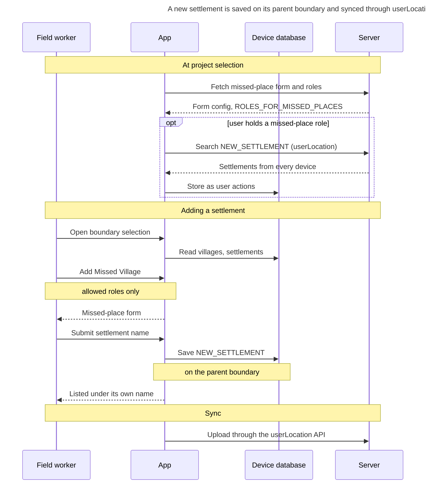

# HCM-v2.2 — Release Notes

Nov 6, 2026 · @Naveen R

HCM-v2.2 of the field worker app adds **outside household vaccination** and **worker-added new settlements**, and stops duplicate beneficiary IDs. It applies to Polio-style campaigns and ships as app 2.2.0 with eight packages on pub.dev.

> **From** HCM-v2.1 **to** HCM-v2.2 · **Validated on** unified-qa (device) and DEMO · **Breaking:** yes, local database schema 12 → 13 (§4) · **Sources:** `outside_household` diff from `hcm-v2.1-dev` (`b1585809e..e13df7d09`), package CHANGELOGs, QA and DEMO MDMS

## 1. Overview of Changes

| Category | What changed in HCM-v2.2 |
| --- | --- |
| New features | Outside household vaccination: transit posts and outside household places as sites (§5.1). New settlements added by workers at the last boundary level (§5.2) |
| Fixes | Duplicate beneficiary IDs: save-time ID check, re-download guard, Default-to-pool upgrade, edit mode, popup and transformer fixes (§5.3). Attendance no longer lists workers enrolled after the marking date; selecting a new settlement no longer crashes the next screen change (§5.4) |
| Campaign scope | Polio-style campaigns only: project types containing `POLIO` or `IMMUNISATION` (`isPolioStyleCampaign`) |
| Packages | 8 on pub.dev: `digit_data_model` 1.5.2, `digit_crud_bloc` 0.1.2, `digit_data_converter` 0.0.5, `digit_forms_engine` 0.1.3, `digit_flow_builder` 0.2.3, `digit_ui_components` 0.3.3, `survey_form` 1.0.6, `transit_post` 1.0.3 (§8) |
| Local database | Schema 12 → 13: facility and project-facility columns and indexes, migrated on app update (§4.1) |
| MDMS | `OUTSIDEHOUSEHOLD` and `MISSEDPLACE` form configs, `HCM.ROLES_FOR_MISSED_PLACES`, DEMO name-pattern fix (§9) |
| Localization | `hcm-outsidehousehold-<campaign>`, `hcm-missedplace-<campaign>`, `hcm-missedplace`; home card labels now use project-type codes such as `HOME_SYNC_DATA_LABEL_POLIO` (§4.7, §9) |
| Backend APIs used | Facility and project-facility create and search (incl. `onlyOutsideHouseholdSites`), userLocation search and create, beneficiary-idgen dispatch (§3) |

## 2. Scope & Impact

| Area | Change | Impact |
| --- | --- | --- |
| Field worker app | 2.2.0 build | Install on all devices of Polio-style campaigns; sync before updating |
| Local database | Schema 12 → 13 migration | Runs on first start of HCM-v2.2; a failed column add is only logged in debug builds (§4.1) |
| Home screen | `IMMUNISATION` treated as Polio-style | IMMUNISATION campaigns get household-strategy registration, missed children, LQA, monitoring and the outside household card (§4.2) |
| Sites | Created on the device as facilities plus project links, uploaded through bulk create | A new facility record on the server for every site created in the field (§4.3) |
| Settlements | `NEW_SETTLEMENT` user actions synced through userLocation | Settlements upload through the location tracker endpoint, not userAction |
| Beneficiary IDs | Save-time allocation | The saved ID can differ from the one shown when it was already taken (§4.4) |
| MDMS and localization | New form configs, roles and modules | Without them the features stay hidden or their forms do not open (§10) |
| Packages | New minimum versions | Apps on `digit_flow_builder` 0.2.3 must take the other new versions together (§4.6) |

## 3. Prerequisites

- **MDMS, per Polio-style campaign:** `HCM-ADMIN-CONSOLE.FormConfig` records `OUTSIDEHOUSEHOLD.<campaign>` (transit and CLF flows) and `MISSEDPLACE` (new settlement form).
- **MDMS, roles:** `HCM.ROLES_FOR_MISSED_PLACES` lists the roles allowed to add a settlement.
- **Localization:** `hcm-outsidehousehold-<campaign>`, `hcm-missedplace-<campaign>` and `hcm-missedplace` published for each locale.
- **Backend:** facility and project-facility services accept bulk create and the `onlyOutsideHouseholdSites` search flag; userLocation search and create are available (location tracker).
- **Beneficiary IDs:** `HCM.BENEFICIARY_ID_CONFIG` set, and each registering user has an ID allocation in beneficiary-idgen. A user with no allocation gets 0 IDs while the app reports success.
- **Form configs:** every `pattern` validation is written as an allow-list, not a negated class (§4.5).
- **Devices:** all pending records synced before the update.

## 4. Breaking Changes

### 4.1 Local database schema 12 → 13

`digit_data_model` 1.5.2 stores outside household sites as facilities. On first start the migration adds:

- `facility`: nullable `client_reference_id`, `latitude`, `longitude`, `location_accuracy`.
- `project_facility`: nullable `client_reference_id` (app-local, never sent to the server).
- Indexes `facility_clientref`, `facility_usage`, `project_facility_clientref`.

The column additions share one try/catch that logs only in debug builds, so one failed column skips the rest without an error.

### 4.2 IMMUNISATION campaigns behave like Polio

`isPolioStyleCampaign` matches project types containing `POLIO` or `IMMUNISATION`. Home-screen checks that used to match `POLIO` only now cover IMMUNISATION campaigns too.

### 4.3 Facilities created on the device now upload

`create` on the facility and project-facility local repositories now defaults to writing an oplog entry, so a site created in the field is uploaded. Downloads through `bulkCreate` still write none.

### 4.4 The saved beneficiary ID can differ from the one shown

Each save re-checks the identifier. A used ID, one owned by another user, or one already given out in the same save is replaced with the user's oldest free ID, and a Default (UUID) identifier is upgraded to a pool ID.

### 4.5 Negated character classes in `pattern` validations

The app turns a field's `pattern` into a keystroke filter. A negated class such as `[^!@#$%]` is turned around into "only these characters", and the first keystroke wipes the field. Write allow-lists, for example `^(?![+])[a-zA-Z0-9 ,.'()/&_:+-]+$`.

### 4.6 Package minimum versions

`digit_flow_builder` 0.2.3 requires `digit_data_model` ^1.5.2, `digit_forms_engine` ^0.1.3, `digit_crud_bloc` ^0.1.2 and `digit_data_converter` ^0.0.5; `digit_data_converter` 0.0.5 requires `digit_data_model` ^1.5.2. Update them together.

### 4.7 Home card labels use project-type codes

Each home card now translates `<code>_<PROJECTTYPE>`, for example `HOME_SYNC_DATA_LABEL_POLIO` instead of `HOME_SYNC_DATA_LABEL`. There is no fallback to the old code: a missing string shows as its raw code, so gaps are visible. Upload the suffixed codes in the same modules as the base codes before rolling out (§9). Only an unselected project, or one with no `projectType`, uses the plain code.

### 4.8 Login username label key renamed

The login field label is now `USERNAME_PLACEHOLDER` (was `USER_ID_PLACEHOLDER`), and its required message is `USERNAME_PLACEHOLDER_IS_REQUIRED`. Without these strings the login screen shows the raw codes.

## 5. Feature Details

### 5.1 Outside household vaccination

Workers can now vaccinate children at transit posts and other outside household places, from one **Outside Household Vaccination** card on the home screen. It replaces the separate CLF and transit-post cards.

**Field-worker flow**

1. Choose the village, then **Transit Post** or **Outside Household Place**.
2. Search the sites in the selected village and its parent area. Filters narrow by type and area, a nearby search lists the closest sites first, and the screen shows how many sites match.
3. Pick a site with **Select**, or type a new name and tap **Create** to set one up: name, type, area and GPS location.
4. Open the site's overview and record vaccinations; children are tagged to the site.
5. Back from a site list returns to the type selection.

**How sites are stored and synced**

- Transit posts and outside household places are saved as **facilities** (usage `TRANSIT_POST` / `OUTSIDE_HOUSEHOLD_PLACES`), linked to the project through a project-facility record.
- Sites created on the device upload through bulk create. The app downloads only the project's active sites, fetching the site links first, then the sites.
- Planner-created sites without GPS still appear in lists; nearby search places them after located sites.
- A site name must be unique within its type in the area (`notIn` validation).
- Site lists show boundary names, not raw codes; the `hcm-outsidehousehold` localizations are cached at project selection.

```mermaid
sequenceDiagram
    title Sites download at project selection; new sites upload with their links on sync
    participant W as Field worker
    participant A as App
    participant D as Device database
    participant S as Server
    Note over W,S: At project selection
    A->>S: Fetch the project's site links
    S-->>A: Project-facility links
    A->>S: Fetch the linked sites
    S-->>A: Active sites (facilities)
    A->>D: Store sites and links
    Note over W,S: Finding a site
    W->>A: Pick village, site type
    A->>D: Search sites in the area
    D-->>A: Sites, nearest first
    A-->>W: List, count and filters
    alt existing site
        W->>A: Select a site
    else new site
        W->>A: Create: name, type, area
        Note over W,A: name unique per type
        A-->>W: GPS capture popup
        A->>D: Save site and link
    end
    Note over W,S: Vaccination and sync
    W->>A: Record vaccinations
    A->>D: Save, tagged to the site
    A->>S: Bulk-create sites, links, records
    S-->>A: Server IDs replace local IDs
```

Sites come down once at project selection and are searched on the device; a new site is saved locally with its project link and uploads with the vaccination records on the next sync.

**Location capture**

- A new capture popup shows live accuracy, a Good / Fair / Low status, elapsed time and satellite count.
- A reading of 5 m or better saves on its own. A timer (30 s by default) enables **Save** for any reading, so a worker is never stuck.
- Closing the popup leaves the field empty with a recapture icon; a required field then blocks **Continue**.

**Related changes**

- Vaccinated elsewhere: a revisit can record that a child was vaccinated elsewhere (task status `VACCINATED_ELSEWHERE`), which counts as nothing left to deliver.
- Group vaccination at a session records children and referrals as user actions tagged to the session.

### 5.2 New settlements

Workers can add a settlement that is missing from the boundary list, at the lowest level, and work in it like any other village. The new settlement keeps its parent's boundary code, so everything sent to the server still sits on an existing boundary; only the displayed name differs.

**Field-worker flow**

1. On boundary selection, under the last level, tap **Add Missed Village** ("Didn't find your village?").
2. Fill in the missed-place form, which comes from the project's MDMS FormConfig; its localizations are cached at project selection.
3. The settlement appears in the village list under its own name and can be selected.

**Rules and sync**

- Only roles listed in MDMS `HCM.ROLES_FOR_MISSED_PLACES` see **Add Missed Village**.
- The settlement is saved as a `NEW_SETTLEMENT` user action against the parent boundary, with the typed name in `additionalFields`.
- It uploads through the location tracker's userLocation endpoint, including from **Sync Data**.
- At project selection the app downloads the project's settlements from the userLocation search, so settlements added on another device, or before a reinstall, are listed. Only users holding a role in `HCM.ROLES_FOR_MISSED_PLACES` download them; other roles skip the download. A failed download is shown and can be retried.
- After the form saves, the new settlement is pre-selected on the last level. Picking it again in the dropdown no longer crashes the next screen change.
- Screens that show the boundary (header chip, forms, survey boundary view) use the settlement's own name instead of the parent's.



Settlements from every device come down at project selection; a new one is saved on its parent boundary and uploads through the location tracker's userLocation endpoint, not the user-action one.

**Package side:** `BoundaryModel` gains `NEW_SETTLEMENT` handling (`isNewSettlement`, `selectionKey`, `displayName`), and boundary selection de-duplicates by settlement, not by the shared parent code (`digit_data_model` 1.5.2, `digit_flow_builder` 0.2.2, `survey_form` 1.0.6).

### 5.3 Beneficiary ID fixes

HCM-v2.2 includes five fixes from `azm-smc-adamawa-id-pool-duplicate-fix` that stop two people getting the same beneficiary ID.

| Issue | Fix in HCM-v2.2 | Where |
| --- | --- | --- |
| RC-03: a used ID given to a second person | Every save re-checks the ID; a used one, one owned by another user, or one already given in the same save is replaced by the user's oldest free ID | App (`BeneficiaryIdAllocator`) |
| RC-04, RC-06: Skip or a 0 minimum saved a device UUID | A Default (UUID) identifier is upgraded to a free pool ID at save time | App |
| RC-15: re-downloading IDs before sync freed used IDs | IDs used on the device but not yet synced stay marked as used | App (`UniqueIdBloc`) |
| RC-14: editing a person never assigned a pool ID | `UPDATE_IDENTIFIER_STATUS` supports an edit mode (`"mode": "edit"`) | App; needs MDMS config |
| RC-05: a hidden popup button crashed the popup | Popup footers drop hidden buttons | `digit_flow_builder` 0.2.3 |
| RC-01: the transformer wiped the screen's state | `FETCH_TRANSFORMER_CONFIG` replaces only the form data | `digit_flow_builder` 0.2.3 |

RC-02 (a), the older search screen's **Register** button greyed out, was already fixed on this branch.

### 5.4 Other fixes and changes

- **Attendance enrollment date:** the register, its Submit gate, the card count and QR scanning now skip attendees enrolled after the marking date. Before, a worker enrolled from a future date could be marked.
- **Missed-place dropdown crash:** selecting a just-added settlement rebuilt the open dropdown, and `MultiSelectDropDown` then disposed the page's overlay ("setState() called after dispose(): OverlayState"). The app no longer rebuilds it on a pick. The library bug is still in `digit_ui_components` 0.3.3, so other screens can hit it.
- **Form header tag:** a form page can show a pin tag under its description through `conditions.headerTag`, for example the boundary a missed place is added under.
- **Location capture text:** the save rule now says the location is saved automatically once accuracy is reached, instead of promising a timer.
- **No-result illustrations:** every illustration is drawn at the original 128 px height.

## 6. Upgrade Steps

### Step 1 — MDMS configurations

- Publish `OUTSIDEHOUSEHOLD.<campaign>` and `MISSEDPLACE` in `HCM-ADMIN-CONSOLE.FormConfig` for each Polio-style campaign.
- Add the allowed roles to `HCM.ROLES_FOR_MISSED_PLACES`.
- On DEMO, apply `base_updated.json`: the transit post and outside household place name patterns become allow-lists (§4.5).

### Step 2 — Seed data & localization

- Import `hcm-outsidehousehold-<campaign>`, `hcm-missedplace-<campaign>` and `hcm-missedplace` for each locale.
- Make sure registering users have beneficiary ID allocations in beneficiary-idgen.

### Step 3 — Packages

Point apps at the pub.dev versions in §9, taken together (§4.6). The HCM app resolves them from the repo through `pubspec_overrides.yaml`.

## 8. Package Reference

All eight packages are live on pub.dev. Each package's CHANGELOG carries the full list.

| Package | Version | Main changes for HCM-v2.2 |
| --- | --- | --- |
| `digit_data_model` | 1.5.2 | Sites stored as facilities; **local DB schema 12 → 13** (new facility and project-facility columns, migrated on app update); new-settlement boundary handling; boundary order by level |
| `digit_crud_bloc` | 0.1.2 | Nearby search fix (radius in degrees); `withinOrUnlocated` filter; nearest-first `__distance` sort |
| `digit_data_converter` | 0.0.5 | `__default:` directive for fallback values |
| `digit_forms_engine` | 0.1.3 | Location capture popup and GPS warm-up; `notIn` unique-name validation; summary-page fixes |
| `digit_flow_builder` | 0.2.3 | Outside household widgets and configs, delivery-method scoping, new-settlement names; 0.2.3 adds the popup and transformer fixes |
| `digit_ui_components` | 0.3.3 | `NaturePeople` icon for the outside household place card |
| `survey_form` | 1.0.6 | New settlement shows its own name |
| `transit_post` | 1.0.3 | User-action search applies action, project and boundary filters |

`digit_flow_builder` 0.2.3 requires `digit_data_model` ^1.5.2 and the other new versions; apps on the old versions must update together.

Two packages changed after these versions were published on 6 Nov: `digit_forms_engine` (header tag, location capture text) and `digit_flow_builder` (no-result illustration size). Publish new versions of both before the release build, or those changes stay only in the in-repo build.

## 9. MDMS & Config Reference

The app reads these features from MDMS, so each environment needs its config before workers use them.

- **Outside household:** the project's `OUTSIDEHOUSEHOLD` FormConfig (transit and CLF flows); the `hcm-outsidehousehold-<project>` localization module.
- **New settlements:** the missed-place FormConfig, and `HCM.ROLES_FOR_MISSED_PLACES` listing the roles that may add one.
- **Beneficiary IDs:** RC-05 (hide **Skip** when no IDs) and RC-14 (edit mode) need MDMS config. Release the HCM-v2.2 app first: older builds crash when a popup button is hidden.
- **Name patterns:** the transit post and outside household place name fields on DEMO used `^(?!\+)[^!@#$%^*;<>?|\\~{}\[\]"=\r\n\t]+$`, which wiped the name on the first keystroke. Use the allow-list pattern `^(?![+])[a-zA-Z0-9 ,.'()/&_:+-]+$` instead (`base_updated.json`). QA, UAT and DEV were not affected.
- **Pattern rule for config authors:** the app's input filter mishandles negated character classes (`[^…]`). Write `pattern` validations as allow-lists.
- **Missed-place localization:** the base module is now `hcm-missedplace` (was `hcm-base-missedplace-polio`), alongside `hcm-missedplace-<campaign>`.
- **Home card labels:** upload `<code>_<PROJECTTYPE>` for every home card a project shows, for example `HOME_POLIO_REGISTRATION_LABEL_POLIO`, `HOME_OUTSIDE_HOUSEHOLD_VACCINATION_LABEL_POLIO` and `HOME_SYNC_DATA_LABEL_POLIO`, in the same module as the base code (§4.7).
- **Login:** upload `USERNAME_PLACEHOLDER` and `USERNAME_PLACEHOLDER_IS_REQUIRED` (§4.8).
